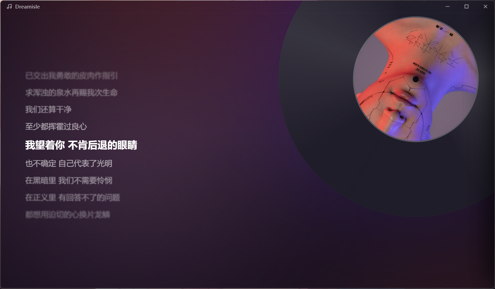

# 音梦屿

音梦屿（Dreamisle）是一个使用 Electron 构建的本地音乐播放器，支持 Windows 10/11。

中文 | [English](./README/README.en.md)



## 功能

- **本地曲库**：递归扫描文件夹；支持 MP3、FLAC、WAV、OGG、M4A；使用 `music-metadata` 读取标题、歌手、专辑、码率、采样率、位深和内嵌封面。
- **播放控制**：列表循环、单曲循环、随机播放；持久化曲库路径、播放进度、音量和播放模式。
- **歌词**：优先读取同名 `.lrc`，其次读取内嵌歌词；支持同时间戳双行、括号、竖线、Tab、薄空格等双语格式；支持 `[offset:]` 校正、翻译开关、点击歌词跳转；超宽行在行内水平滚动。
- **桌面歌词**：置顶悬浮窗；可调背景/文字不透明度、文字颜色和字体；可开启鼠标穿透；`Ctrl+Alt+L` 开关。
- **任务栏歌词（Windows 10/11）**：在任务栏空档显示封面和两行歌词，自动避开应用按钮和通知区域；固定长度，切歌时不会带动任务栏图标；字体、字重、颜色可单独设置；`Ctrl+Alt+T` 或托盘菜单开关。
- **小窗模式**：`F5` 切换 300×340 置顶小窗，显示封面、曲目信息、当前/下一句歌词、进度和控制按钮。
- **界面**：背景随封面主色变化；封面按主色生成辉光；播放列表使用半透明模糊背景；鼠标离开窗口底部时播放栏自动隐藏；在封面区域滚动滚轮调节音量。
- **播放统计**：长按左 `Shift` 0.5 秒打开统计面板，显示当前曲目音质（Hi-Res / SQ / HQ）、完整播放/单曲循环次数、总播放次数、日均播放和歌曲播放排行。
- **十段均衡器**：31Hz–16kHz，±12dB；提供原声、流行、摇滚、爵士、古典、电子、低音增强、人声、深夜九组预设；手动调整后切换为自定义曲线；自动前级抵消最大提升；关闭时保持原始音频链路。
- **歌单**：右键添加歌曲，拖拽排序，重命名/删除；在队列和曲库之间切换。
- **搜索与排序**：按歌名/歌手/随机排序，实时过滤；歌名和歌手排序下提供 A-Z# 索引（中英文按拼音混排）。
- **系统媒体控制**：接入 Windows SMTC，支持媒体键和系统音量浮层，显示封面、曲目信息和播放进度。
- **中英文界面**：界面文案和帮助支持中文/English。

## 快捷键

| 快捷键 | 功能 |
| --- | --- |
| Space | 播放 / 暂停 |
| Q / E | 上一曲 / 下一曲 |
| R | 切换播放模式（列表循环 / 单曲循环 / 随机） |
| 长按左 Alt 0.5s | 显示 / 隐藏播放列表 |
| 长按左 Ctrl 0.5s | 显示 / 隐藏歌单 |
| 长按左 Shift 0.5s | 显示 / 隐藏播放统计 |
| F5 | 切换小窗模式 |
| Ctrl + , | 打开设置 |
| Ctrl + Alt + L | 显示 / 隐藏桌面歌词 |
| Ctrl + Alt + T | 显示 / 隐藏任务栏歌词 |
| H | 打开 / 关闭帮助 |
| Esc | 依次关闭菜单 / 浮层 / 抽屉 |
| 封面区域滚轮 | 调节音量 |
| 点击歌词行 | 跳转到对应播放位置 |

任务栏歌词的 `Ctrl+Alt+T` 只响应左侧 Ctrl/Alt，避免与 AltGr 冲突。

## 技术栈

- Electron 40（ESM）
- 原生 JavaScript / CSS
- `electron-store`：设置与状态持久化
- `music-metadata`：音频元数据与内嵌封面
- Web Audio API：十段 peaking BiquadFilter 级联 + 自动前级
- `koffi` + Win32 API：任务栏歌词定位、DPI、主题等 Windows 集成

## 开发

环境要求：Node.js 与 npm。

```bash
npm install
npm start          # 启动开发版
npm run build:win  # 构建 Windows 安装包
npm run format     # Prettier 格式化
```

安装器使用 NSIS，桌面快捷方式为可选项，默认不创建；静默更新不会修改桌面图标。

## 项目结构

```text
Dreamisle-electron/
├── README.md                  # 中文说明
├── README/README.en.md        # 英文说明
├── build/installer.nsh        # NSIS 安装器自定义（桌面快捷方式选项）
├── img/                       # 文档截图
└── src/
    ├── main/                  # 主进程：窗口、托盘、曲库、歌单、持久化、IPC
    ├── preload/               # 预加载桥接（主窗口 / 桌面歌词 / 任务栏歌词）
    ├── lyrics/                # 桌面歌词悬浮窗
    ├── taskbar/               # Windows 任务栏歌词（Win32 定位、布局、渲染、日志）
    ├── shared/                # 主/渲染共享纯逻辑（歌词解析、i18n、均衡器、统计、任务栏歌词文档与样式）
    ├── renderer/              # 主窗口渲染进程（HTML / JS / CSS）
    └── assets/                # 应用图标
```

## License

MIT
