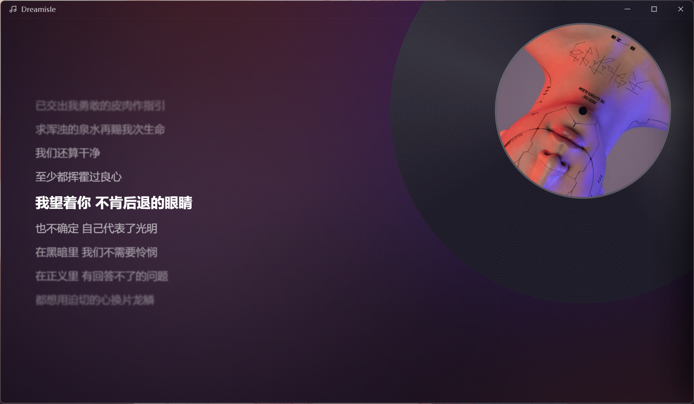

# 音梦屿（Dreamisle）

音梦屿是一个基于 Electron 的本地音乐播放器，播放本地音频文件，不提供在线音乐服务。

- 支持平台：Windows 10/11（x64）、macOS 12+（Intel / Apple Silicon）
- 界面语言：简体中文 / English
- 许可证：MIT

中文 | [English](./README/README.en.md)



## 功能

- **本地曲库**：递归扫描设置中的音乐文件夹，支持 MP3、FLAC、WAV、OGG、M4A；使用 `music-metadata` 读取标题、歌手、专辑、码率、采样率、位深和内嵌封面。
- **播放**：列表循环、单曲循环、随机播放；持久化音量、播放进度和播放模式。
- **播放队列**：底部按钮打开当前播放队列；右键歌曲可「下一首播放 / 添加到播放队列 / 从播放队列移除」；支持拖动排序和清空，重启后恢复。
- **歌单**：创建、重命名、删除歌单；右键添加歌曲、拖动排序；点击歌单将其歌曲作为播放队列。
- **文件夹视图**：按设置的曲库根目录生成文件夹树，父文件夹包含其子文件夹的歌曲；点击文件夹可将整棵子树的歌曲作为播放队列，不创建歌单。
- **歌词**：优先读取同目录同名 `.lrc`，其次读取内嵌歌词；支持同时间戳双语、`[offset:]` 校正、翻译开关、点击跳转和长行水平滚动。作词、作曲、制作、赞助、版权、平台翻译声明以及歌名/歌手头部会自动隐藏，只显示歌词与翻译。
- **桌面歌词**：置顶悬浮窗；可调背景/文字不透明度、颜色和字体；支持单行/双行显示（第二行优先显示翻译，没有翻译时显示下一句）；支持鼠标穿透，关闭穿透后可拖动窗口；`Ctrl+Alt+L` / `Cmd+Option+L` 开关。
- **任务栏歌词（Windows 10/11）**：在任务栏空档显示封面和两行歌词；字体、字重、颜色独立设置；`Ctrl+Alt+T` 或托盘菜单开关。
- **菜单栏歌词（macOS）**：在状态栏图标旁显示当前歌词行；无时间轴歌词时显示歌名/歌手；超长行截断；`Cmd+Option+T` 或托盘菜单开关。
- **搜索与排序**：按歌名/歌手排序或随机，实时过滤；歌名/歌手排序下提供 A-Z# 索引（中文按拼音）。
- **播放统计**：长按左 `Shift` 0.5 秒打开；统计音质分级（Hi-Res / SQ / HQ）、完整播放/循环次数、总播放次数、日均播放和歌曲排行。
- **十段均衡器**：31 Hz–16 kHz，±12 dB，9 组预设和自动前级；关闭时旁路音频处理。
- **小窗模式**：`F5` 切换 300×340 固定窗口，显示封面、曲目信息、当前/下一句歌词、进度和控制键。
- **系统媒体控制（Windows）**：通过 SMTC 支持媒体键和系统媒体浮层（封面、曲目信息、进度）。
- **界面**：封面主色驱动背景与辉光；播放栏自动隐藏；封面区域滚轮调节音量。
- **性能模式**：在设置中关闭背景模糊与氛围光、唱片、频谱动画，降低集成显卡等弱 GPU 设备的负担。
- **中英文界面**：界面文案与帮助支持中文 / English。

## 系统要求

| 平台 | 要求 |
| --- | --- |
| Windows | Windows 10/11 x64 |
| macOS | macOS 12 或更高（Intel / Apple Silicon） |
| 开发 | Node.js 22.12+（Electron 40 的最低要求）、npm |

## 安装

项目暂未提供正式 Release，安装包来自 GitHub Actions 的构建产物（Artifacts），或从源码构建。

- **Windows**：运行 NSIS 安装包。安装包未签名，SmartScreen 可能提示，需选择「更多信息 → 仍要运行」。
- **macOS**：打开 DMG，将 Dreamisle 拖入「应用程序」。构建默认使用 ad-hoc 签名且未公证，首次启动可能需要在「系统设置 → 隐私与安全性」中允许打开。

## 使用

1. 首次启动时按提示添加一个或多个音乐文件夹。
2. 底部控制栏的列表按钮打开播放队列；右键歌曲可加入播放队列或歌单。
3. 长按左 `Ctrl` 打开歌单与文件夹视图；长按左 `Alt` 打开播放队列。
4. 设置中可切换语言、主题、歌词样式、均衡器和音乐文件夹。

## 快捷键

| 快捷键 | 功能 |
| --- | --- |
| Space | 播放 / 暂停 |
| Q / E | 上一曲 / 下一曲 |
| R | 切换播放模式（列表循环 / 单曲循环 / 随机） |
| 长按左 Alt 0.5s | 显示 / 隐藏播放队列 |
| 长按左 Ctrl 0.5s | 显示 / 隐藏歌单 |
| 长按左 Shift 0.5s | 显示 / 隐藏播放统计 |
| F5 | 切换小窗模式 |
| Ctrl+, / Cmd+, | 打开设置 |
| Ctrl+Alt+L / Cmd+Option+L | 显示 / 隐藏桌面歌词 |
| Ctrl+Alt+T | 显示 / 隐藏任务栏歌词（仅 Windows） |
| Cmd+Option+T | 显示 / 隐藏菜单栏歌词（仅 macOS） |
| H | 打开 / 关闭帮助 |
| Esc | 依次关闭菜单 / 浮层 / 抽屉 |
| 封面区域滚轮 | 调节音量 |
| 点击歌词行 | 跳转到对应播放位置 |

说明：Windows 任务栏歌词的 `Ctrl+Alt+T` 仅响应左侧 Ctrl/Alt，避免与 AltGr 冲突；macOS 上的长按类快捷键对应 ⌥ / ⌃ / ⇧。

## 已知限制

- Windows 任务栏歌词依赖 Win32 / UIA 定位；使用第三方任务栏或高度定制的任务栏时可能无法嵌入。嵌入失败不会修改设置，仍可通过托盘菜单或设置关闭。
- macOS 菜单栏歌词为单行文本，超长歌词会截断，不显示翻译或逐字高亮。
- 桌面歌词第一行显示原文，第二行优先显示翻译（受翻译开关控制），没有翻译时显示下一句；菜单栏歌词只显示原文。
- 均衡器仅作用于应用内的播放链路，不影响系统声音。
- 未实现自动更新，需要手动替换安装包。

## 数据与配置

- 配置文件由 `electron-store` 保存：
  - Windows：`%APPDATA%\dreamisle\config.json`
  - macOS：`~/Library/Application Support/dreamisle/config.json`
- 歌词查找顺序：同目录同名 `.lrc` → 音频内嵌歌词。
- 曲库缓存、播放进度、音量、播放模式、播放队列和设置均保存在上述配置文件，删除前请备份。

## 技术栈

- Electron 40（ESM）
- 原生 JavaScript / CSS
- `electron-store`：设置与状态持久化
- `music-metadata`：音频元数据与内嵌封面
- Web Audio API：10 段 peaking BiquadFilter 级联 + 自动前级
- `koffi` + Win32 API：任务栏歌词定位、DPI、主题等 Windows 集成

## 开发

环境要求：Node.js 22.12+（Electron 40 的最低要求）。

```bash
npm ci
npm start          # 开发模式
npm run build:win  # 构建 Windows 安装包
npm run build:mac  # 构建 macOS DMG
npm run format     # Prettier 格式化 src/
```

- 构建产物输出到 `dist/`。
- `build:mac` 默认使用 ad-hoc 签名（`--config.mac.identity=-`），未公证；对外分发需要配置 Developer ID 证书并完成公证。
- Windows 安装包默认未签名；对外分发建议配置代码签名证书。
- GitHub Actions 在每次 push 时构建 Windows 与 macOS 产物（Artifacts）。

## 项目结构

```text
Dreamisle-electron/
├── README.md                  # 中文说明
├── README/README.en.md        # 英文说明
├── build/                     # electron-builder 资源（NSIS 自定义、macOS entitlements）
├── img/                       # 文档截图
└── src/
    ├── main/                  # 主进程：窗口、托盘、曲库、歌单、播放队列持久化、IPC
    ├── preload/               # 预加载桥接（主窗口 / 桌面歌词 / 任务栏歌词）
    ├── lyrics/                # 桌面歌词悬浮窗
    ├── taskbar/               # Windows 任务栏歌词（Win32 定位、布局、渲染、日志）
    ├── menubar/               # macOS 菜单栏歌词（状态栏标题）
    ├── shared/                # 主/渲染共享纯逻辑（歌词解析、i18n、均衡器、统计、文件夹分组、队列文档/样式）
    ├── renderer/              # 主窗口渲染进程（HTML / JS / CSS）
    └── assets/                # 应用图标
```

## License

MIT
