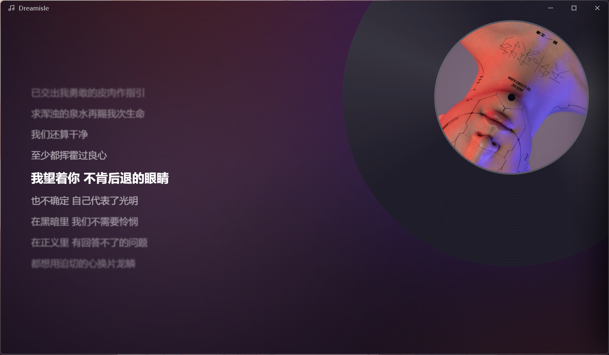

# Dreamisle

Dreamisle is a local music player built with Electron. It plays local audio files and does not provide online music services.

- Platforms: Windows 10/11 (x64), macOS 12+ (Intel / Apple Silicon)
- UI languages: Simplified Chinese / English
- License: MIT

[中文](../README.md) | English



## Features

- **Local library**: Recursively scans configured music folders; supports MP3, FLAC, WAV, OGG, and M4A; reads title, artist, album, bitrate, sample rate, bit depth, and embedded cover art via `music-metadata`.
- **Playback**: List loop, single loop, and shuffle; persists volume, playback progress, and play mode.
- **Play queue**: The button in the player bar opens the current queue. Right-click a song for Play next / Add to queue / Remove from queue; drag to reorder and clear the queue; the queue is restored on restart.
- **Playlists**: Create, rename, and delete playlists; add songs via the context menu and drag to reorder; clicking a playlist uses its songs as the play queue.
- **Folder view**: Builds a folder tree from the configured library roots; a parent folder includes the songs of its subfolders. Clicking a folder uses its entire subtree as the play queue without creating a playlist.
- **Lyrics**: Prefers an adjacent same-name `.lrc`, then embedded lyrics; supports same-timestamp bilingual lines, `[offset:]`, a translation toggle, click-to-seek, and horizontal scrolling for long lines.
- **Desktop lyrics**: Always-on-top overlay; adjustable background/text opacity, color, and font; single-line or double-line display (the second line prefers the translation and falls back to the next lyric); optional click-through, which can be disabled to drag the window; toggle with `Ctrl+Alt+L` / `Cmd+Option+L`.
- **Taskbar lyrics (Windows 10/11)**: Shows cover art and two lyric lines in free taskbar space; font, weight, and color are configurable; toggle with `Ctrl+Alt+T` or the tray menu.
- **Menu bar lyrics (macOS)**: Shows the current lyric line next to the status item; falls back to title/artist when there are no timed lyrics; long lines are truncated; toggle with `Cmd+Option+T` or the tray menu.
- **Search and sorting**: Sort by title/artist or shuffle; real-time filtering; an A-Z# index (Chinese sorted by pinyin) in title/artist modes.
- **Playback statistics**: Hold Left `Shift` for 0.5s; shows quality tiers (Hi-Res / SQ / HQ), full-play/loop counts, total plays, daily average, and a song ranking.
- **10-band equalizer**: 31 Hz–16 kHz, ±12 dB, 9 presets and an auto preamp; bypassed when disabled.
- **Mini mode**: `F5` toggles a 300×340 fixed window with cover, track info, current/next lyric, progress, and controls.
- **System media controls (Windows)**: SMTC media keys and the system media flyout (cover, track info, progress).
- **Interface**: Cover-driven background and glow; auto-hiding playback bar; mouse wheel over the cover adjusts volume.
- **Performance mode**: Disables background blur and the ambient, disc, and spectrum animations, reducing load on integrated or older GPUs.
- **Chinese/English UI**: Interface copy and help are available in both languages.

## Requirements

| Platform | Requirement |
| --- | --- |
| Windows | Windows 10/11 x64 |
| macOS | macOS 12 or later (Intel / Apple Silicon) |
| Development | Node.js 22.12+ (minimum for Electron 40), npm |

## Installation

This project does not currently publish official binary releases. Installers are available from GitHub Actions artifacts, or can be built from source.

- **Windows**: Run the NSIS installer. The installer is unsigned and may trigger SmartScreen; choose More info → Run anyway.
- **macOS**: Open the DMG and drag Dreamisle into Applications. Builds are ad-hoc signed and not notarized; on first launch you may need to allow it in System Settings → Privacy & Security.

## Usage

1. On first launch, add one or more music folders when prompted.
2. Use the list button in the player bar to open the play queue; right-click a song to add it to the queue or a playlist.
3. Hold Left `Ctrl` to open playlists and the folder view; hold Left `Alt` to open the play queue.
4. Settings provide language, theme, lyric style, equalizer, and music folder options.

## Shortcuts

| Shortcut | Action |
| --- | --- |
| Space | Play / pause |
| Q / E | Previous / next track |
| R | Cycle play mode (list loop / single loop / shuffle) |
| Hold Left Alt 0.5s | Show / hide the play queue |
| Hold Left Ctrl 0.5s | Show / hide playlists |
| Hold Left Shift 0.5s | Show / hide playback statistics |
| F5 | Toggle mini mode |
| Ctrl+, / Cmd+, | Open settings |
| Ctrl+Alt+L / Cmd+Option+L | Show / hide desktop lyrics |
| Ctrl+Alt+T | Show / hide taskbar lyrics (Windows only) |
| Cmd+Option+T | Show / hide menu bar lyrics (macOS only) |
| H | Open / close help |
| Esc | Close menu / overlay / drawer in order |
| Mouse wheel over the cover | Adjust volume |
| Click a lyric line | Seek to that position |

Note: on Windows, the taskbar lyrics shortcut (`Ctrl+Alt+T`) responds only to the left Ctrl/Alt keys to avoid conflicts with AltGr. On macOS, the hold shortcuts map to ⌥ / ⌃ / ⇧.

## Known limitations

- Windows taskbar lyrics rely on Win32 / UIA positioning; heavily customized or third-party taskbars may not support embedding. A failed embed does not change the setting, and the feature can still be toggled from the tray menu or settings.
- macOS menu bar lyrics are a single line and truncate long lyrics; they do not show translations or per-word highlighting.
- Desktop lyrics show the original text on the first line; the second line prefers the translation (subject to the translation toggle) and falls back to the next lyric. Menu bar lyrics show the original text only.
- The equalizer affects only the app's playback path, not system audio.
- There is no auto-update; replace the installer manually.

## Data and configuration

- The config file is managed by `electron-store`:
  - Windows: `%APPDATA%\dreamisle\config.json`
  - macOS: `~/Library/Application Support/dreamisle/config.json`
- Lyric lookup order: adjacent same-name `.lrc` → embedded lyrics.
- The config stores the library cache, playback progress, volume, play mode, play queue, and settings. Back it up before deleting it.

## Tech stack

- Electron 40 (ESM)
- Vanilla JavaScript / CSS
- `electron-store`: settings and state persistence
- `music-metadata`: audio metadata and embedded cover art
- Web Audio API: 10 cascaded peaking BiquadFilter nodes plus an auto preamp
- `koffi` + Win32 API: taskbar lyric positioning, DPI, theme, and other Windows integration

## Development

Requirements: Node.js 22.12+ (minimum for Electron 40).

```bash
npm ci
npm start          # development
npm run build:win  # build the Windows installer
npm run build:mac  # build the macOS DMG
npm run format     # format src/ with Prettier
```

- Build output goes to `dist/`.
- `build:mac` uses ad-hoc signing by default (`--config.mac.identity=-`) and is not notarized; distribution requires a Developer ID certificate and notarization.
- Windows installers are unsigned by default; distribution should use a code-signing certificate.
- GitHub Actions builds Windows and macOS artifacts on every push.

## Project structure

```text
Dreamisle-electron/
├── README.md                  # Chinese docs
├── README/README.en.md        # English docs
├── build/                     # electron-builder resources (NSIS customization, macOS entitlements)
├── img/                       # Documentation screenshots
└── src/
    ├── main/                  # Main process: windows, tray, library, playlists, queue persistence, IPC
    ├── preload/               # Preload bridges (main window / desktop lyrics / taskbar lyrics)
    ├── lyrics/                # Desktop lyrics overlay
    ├── taskbar/               # Windows taskbar lyrics (Win32 positioning, layout, renderer, log)
    ├── menubar/               # macOS menu bar lyrics (status item title)
    ├── shared/                # Shared pure logic (lyrics parsing, i18n, equalizer, stats, folder grouping, queue document/style)
    ├── renderer/              # Main window renderer (HTML / JS / CSS)
    └── assets/                # App icon
```

## License

MIT
